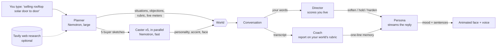

# Dojo

**Type your line of work. Dojo builds a whole training world for it, then lets you talk your way through it out loud.**

Most conversation practice is a fixed script. Dojo has no script. You type what you do, such as *selling rooftop solar door to door*,
*asking investors for a seed round* or *telling a tenant their lease won't be renewed*. NVIDIA Nemotron models running on Nebius
Token Factory then design everything around it:

- the **situations** you will really face, from first contact to the hardest close
- the **objections** people in your field actually say
- **five people** to practise with, each with a personality, an accent and an animated face that reacts as you talk
- a **scoring rubric made for your field**, plus the compliance traps to avoid

Then you talk to them with your voice. While you speak, a second model watches your lines and scores them live. That score changes how
the person answers: they soften when you do well and harden when you ramble or pressure them. When you finish, a coach model scores you
against your world's own rubric, quotes your actual words, and writes the line you should have said. The next conversation starts
with that person remembering your weakest habit.

## How it works



| Job | What it does | When it runs | Model size |
|---|---|---|---|
| **Planner** | Designs the world from one line | once per world | largest Nemotron |
| **Caster** | Creates one person (character, accent, face) | 5 in parallel per world | fast Nemotron |
| **Persona** | Plays the person, streamed sentence by sentence | every turn | fast Nemotron |
| **Director** | Scores your last line on the world's live skills and picks the stance | every turn | fast Nemotron |
| **Coach** | Scores the whole conversation and writes better lines | once per conversation | largest Nemotron |

Each job has its own model setting in `.env`, so cost and speed can be tuned per job. The "Under the hood" panel in a conversation shows
the real model, time to first word and tokens per second for each job.

Details that make it hold together:

- **Whatever the model returns is validated and repaired.** Faces use a fixed set of options, accents come from a list, ids are
  normalised, a missing rubric is topped up, and a failed casting still gives a usable person. A messy answer never breaks a world.
- **Reasoning models are handled.** `<think>` blocks and code fences are stripped from streamed and non-streamed output, so thinking is never spoken.
- **Built worlds are cached** by line of work. Asking for the same thing twice costs nothing, and every visitor can reuse a world.
- **Safe by design.** The planner refuses scams, harassment and deception. The coach flags pressure and misleading claims.
  Your typed text is treated as data inside the planner prompt, not as instructions.
- **Cost protection for a public demo:** a per-visitor hourly limit, a daily cap on new worlds, a daily cap on model calls, and ready-made
  worlds that work even when the caps are reached.
- Optional **Tavily** web research makes the objections and situations reflect how the field really works right now.

## Run it

You need Python 3.10 or newer and a Nebius Token Factory API key (https://tokenfactory.nebius.com).

```bash
git clone https://github.com/Zarif0606/dojo && cd dojo
cp .env.example .env        # then add your key and the Nemotron model IDs from the Token Factory model list
./start.sh                  # opens http://localhost:8000 in Chrome or Edge
```

Try it with no AI at all: `./start.sh mock`. Work offline with a local model: `LLM_PROVIDER=ollama`.

Use Chrome or Edge for voice input (the browser's speech recognition) and headphones so the mic doesn't hear the character. You can always type instead.

## Project layout

```
app/worlds.py     the world generator: planner, parallel casters, validation, caching, streaming build events
app/llm.py        one OpenAI-compatible client for five model roles, <think> handling, per-role speed and token stats, daily cap
app/prompts.py    persona, director and coach prompts, generated from the world's own rubric
app/main.py       FastAPI: worlds, sessions, streaming turns, coaching, progress
app/db.py         SQLite: worlds, sessions, coach memory
static/           plain HTML, CSS and JavaScript (no build step): faces, scenes, voice, UI
```

## Credits and licence

Built for the Nebius x NVIDIA Global AI Hackathon with NVIDIA Nemotron on Nebius Token Factory and Tavily. MIT licensed, see `LICENSE`.
Practice conversations are for rehearsal only. Don't type real client details into any AI service.
